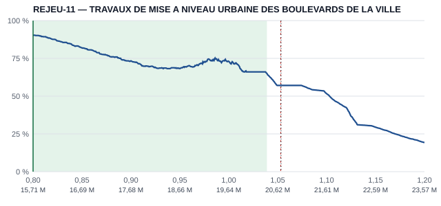
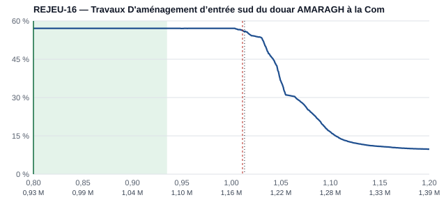
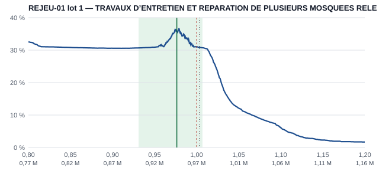

# Copilote — étape C : taux de chaque société et simulation de l'ouverture des plis

Tests : `python -m unittest discover -s tests -t .` → **362 OK** (dont 37 dans `tests/test_simulateur.py`, 7 cas communs
dans `tests/cas_simulation.json`). `python tester_ao_ouverts.py` → tous les contrôles passent. `serveur.py` n'est pas modifié.
Mesures : `python -m copilote.mesures_simulation tout` (≈ 25 min) → `rapports/copilote_etape_C_mesures.json`.
Tous les réglages sont appris sur 2025 (données arrêtées au 31/12/2025) et mesurés sur 2026.

## Corrections faites avant l'étape C

**a) « Probables par association » désactivées** (`copilote/reglages.json`, section `probables`, `association: false` ;
code conservé). Elles ne sont plus ajoutées ni à la liste, ni aux groupes, ni au nombre de concurrents.
Les 4 prévisions déjà figées ne sont pas touchées.

| critère A2 | 2026, 500 marchés : avant | après | 20 AO REJEU (27 lots) : avant | après |
|---|---:|---:|---:|---:|
| vrais soumissionnaires dans le top 15 (seuil 30 %) | 33,6 % | **33,8 %** | 41,4 % | 40,5 % |
| vrai gagnant dans le top 30 (seuil 40 %) | 43,6 % | **43,4 %** | 66,7 % | 70,4 % |
| vrai nombre dans la fourchette 80 % (seuil 70–90 %) | 80,0 % | **80,0 %** | 70,4 % | 70,4 % |
| largeur moyenne de la fourchette | 10,8 | 10,8 | 10,3 | 10,2 |
| membres de groupe retrouvés | 60,3 % | 53,6 % | 80,0 % | 75,0 % |
| taille de la liste | 22,0 | 20,0 | 23,5 | 22,1 |
| groupes par marché | 2,4 | 1,7 | 2,9 | 2,5 |
| sociétés ajoutées par association par marché | 2,0 | 0 | 1,4 | 0 |

Les trois seuils FEU VERT de l'étape A restent atteints. Seul recul : les membres de groupe retrouvés (−6,7 points), car
l'association en ramenait quelques-uns (26 vrais soumissionnaires sur 500 marchés).

**b) Groupes peu probables repliés** : la page montre d'abord les groupes dont le chef de file vient avec ≥ 15 %
(`seuil_groupe_affiche`, réglable). Les autres sont dans « Groupes peu probables (n) ». La simulation garde tous les groupes.

**Habituées** (décision du 03/11) : formule apprise sur 2024 + 2025. Sur 2026, les tranches hautes restent loin
des ±10 points (80–90 % : +12,3 → +11,5 ; 90–100 % : +13,7 → +10,0), donc la version A2 est **gardée**. Limite : 2024 ne
contient que octobre–décembre, sans historique antérieur.

## Ce qui est fait

1. **Taux de chaque société** (`copilote/taux.py`) :
   - Moyenne pondérée de ses taux passés : poids = similarité^0,5 × 0,5^(âge / 45 j) × (1 + 3 si même acheteur).
   - Ramenée vers le segment (acheteur, famille, tranche de montant) selon le nombre de marchés équivalents (k = 3).
   - Fourchette 10–90 %.
   - Membres de groupe : deux profils, chef de file présent ou absent, avec l'écart habituel à l'offre du chef.
   - Effet de marché : choc commun, plus un décalage selon le nombre d'offres (d(N) = constante + pente × ln N ;
     moins il y a de concurrents, plus les offres sont hautes).
   - Réglages appris sur 300 marchés de 2025 (2 097 offres) : écart moyen **4,06 points** contre 4,36 pour la base simple
     (moyenne des taux passés), couverture 10–90 % : 79,8 %.
2. **Concurrents non identifiés** : leur nombre vient de A2, leurs taux de la distribution du segment avant la coupure.
3. **Simulateur** en deux copies identiques (`statique/simulateur.js`, `copilote/simulateur.py`) :
   - Même graine = même courbe, testé sur 7 cas communs.
   - La règle rapide est vérifiée contre `prix_de_reference` / `classement_commission` de construire_base.py.
   - 4 000 scénarios, courbe de 0,80 à 1,20 au pas de 0,0005 : **≈ 80 ms** dans le navigateur (test < 300 ms).
4. **Page d'analyse** :
   - ④ taux par société : sous-historique dépliable, taux modifiable avec l'original rappelé, réversible.
   - ⑤ courbe SVG en taux et en dirhams, avec zone recommandée, distribution de P (sans notre offre), position probable
     de chaque chef de file et scénario central.
   - Tout est recalculé dans le navigateur.
   - La prévision figée garde maintenant la courbe et la zone.
   - En REJEU : vrai P, offre gagnante réelle, et ce qu'aurait donné notre point recommandé.
5. **REJEU-R prêt** : `python -m copilote.rejeu_recent` écrit aussi la section « Étape C » (mêmes mesures).

**Corrections appliquées après la première mesure** (critères KO, voir § Mesures) :
- Point recommandé : maximum de la courbe lissée.
- Choc de marché ×1,8 : l'intervalle 80 % de P était trop étroit (68 % en 2026). Trois facteurs essayés sur 2025 : 1,0 → 73 %,
  1,4 → 77 %, **1,8 → 79 %**.
- Table de calibration de la chance (régression isotone, 294 marchés de 2025), appliquée dans les deux copies.
  La table est croissante, donc le point recommandé et la zone se lisent sur la courbe simulée ; la chance affichée est calibrée.

## Mesures (2026 : 500 marchés ; REJEU : 27 marchés ou lots)

| critère FEU VERT | 2026 | REJEU | seuil | |
|---|---:|---:|---|---|
| (a) vrai P dans l'intervalle 80 % | **79,6 %** | 96,3 % | 70 à 90 % | **OK** |
| (b) écart moyen de P (points) | **2,55** | 1,71 | < 2,43 | **KO** contre 2,43 ; **OK** contre l'étape 4 sur les mêmes marchés (2,63 ; REJEU 2,11) |
| (b') écart médian de P | 1,82 | 1,35 | étape 4 : 1,74 ; REJEU 2,01 | mitigé |
| (c) calibration ±5 points par tranche | 8 tranches sur 10 | non | ±5 | **KO partiel** |
| (d) zone ≥ meilleur taux fixe | 55,6 % | 37,0 % | 59,6 % ; REJEU 40,7 % | **KO** |

Le 2,43 de l'étape 4 a été mesuré sur un autre échantillon de 2026. Sur les 500 mêmes marchés, la méthode de l'étape 4 fait
2,63 : la simulation fait mieux en moyenne (−0,08 point), un peu moins bien en médiane (+0,08).

**(c) Calibration, 2026** (chance annoncée sur toute la courbe, un point tous les 0,01) :

| annoncée | n | annoncée | réelle | écart |
|---|---:|---:|---:|---:|
| 0–10 % | 179 | 7,2 % | 3,9 % | +3,3 |
| 10–20 % | 406 | 14,0 % | 16,0 % | −2,1 |
| 20–30 % | 356 | 25,9 % | 21,6 % | +4,3 |
| 30–40 % | 339 | 32,7 % | 24,8 % | **+7,9** |
| 40–50 % | 346 | 45,5 % | 42,8 % | +2,7 |
| 50–60 % | 1 493 | 55,6 % | 53,7 % | +1,9 |
| 60–70 % | 262 | 64,7 % | 73,3 % | **−8,6** |
| 70–80 % | 26 | 74,5 % | 76,9 % | −2,5 |
| 80–90 % | 15 | 84,4 % | 86,7 % | −2,3 |
| 90–100 % | 29 | 96,2 % | 93,1 % | +3,0 |

Au point recommandé : 54,1 % annoncé, 55,6 % réel. Avant la table, l'écart allait jusqu'à +13 points.
En REJEU, la chance est très surestimée (53,7 % annoncé, 37,0 % réel) : ce sont surtout de gros marchés, où le nombre
d'offres est sous-estimé.

**(d) Zone contre taux fixes, 2026** (victoires de notre offre au point recommandé, parmi les vraies offres) :

| offres | n | zone | meilleur taux fixe (choisi après coup) | 0,95 fixe | offres réelles / simulées |
|---|---:|---:|---:|---:|---:|
| 1-2 | 192 | 92,7 % | 94,8 % à 0,8025 | 87,0 % | 1,4 / 3,7 |
| 3-4 | 98 | 62,2 % | 71,4 % à 0,8025 | 42,9 % | 3,4 / 5,7 |
| 5-7 | 86 | 29,1 % | 37,2 % à 0,805 | 20,9 % | 5,8 / 6,4 |
| 8+ | 117 | 8,6 % | 14,5 % à 1,01 | 7,7 % | 18,7 / 8,5 |
| tout | 493 | 55,6 % | 59,6 % à 0,805 | 47,9 % | |

## Limites et corrections proposées

- **(d) vient surtout du nombre de concurrents de A2** : trop haut sur les petits marchés (3,7 simulées contre 1,4 réelles),
  trop bas sur les gros (8,5 contre 18,7).
  - La zone part donc vers 0,80 là où un prix proche de P gagnerait, et inversement.
  - Correction proposée : recaler le nombre simulé sur le nombre réel, par tranche de nombre prévu, en apprenant sur 2025.
    Elle touche A2, déjà validée : c'est à décider.
- **Objectif « meilleure chance »** : le meilleur taux fixe est presque toujours 0,80, le bas de la grille. Sans coût,
  baisser le prix augmente souvent la chance. L'étape 8 (coût, marge) donnera le vrai plancher. Le « meilleur taux fixe »
  est choisi après coup sur 2026 : c'est une borne haute, pas une règle utilisable à l'avance.
- **(c)** Deux tranches hors ±5 (30–40 % et 60–70 %). La table a des paliers : toute chance simulée de 70 à 80 % vaut
  ≈ 57 % réel en 2025, d'où des courbes plates à 57 % (exemple 2). Piste : une table lissée (logistique à 2 paramètres).
- REJEU : 27 lots seulement, souvent gros ; les chiffres y varient beaucoup.

## Trois exemples de courbes (REJEU, réglages finaux)

Vert : zone recommandée et point recommandé. Rouge pointillé : offre gagnante réelle. Noir pointillé : vrai P.
Les montants en dirhams sont sous l'axe.

**1. REJEU-11** — mise à niveau urbaine d'Ahfir, 19,6 M DH, 4 offres réelles (2,0 simulées).
- Zone 0,800 à 1,039 ; meilleure chance 90,3 % à 0,800.
- P simulé 1,062 [1,021 ; 1,103] ; vrai P 1,053, dans l'intervalle.
- Gagnant réel à 1,053 (chance annoncée à ce taux : 57 %).
- **Notre point recommandé aurait gagné.**

**2. REJEU-16** — entrée sud du douar Amaragh (Tiznit), 1,16 M DH, **19 offres réelles contre 4,8 simulées**.
- Zone 0,800 à 0,935 ; 57,1 % (palier de la table).
- P simulé 1,034 [0,997 ; 1,074] ; vrai P 1,013, dans l'intervalle.
- Gagnant réel à 1,011.
- **Notre point aurait perdu** : c'est le cas typique du nombre sous-estimé.

**3. REJEU-01 lot 1** — entretien de mosquées (Tanger-Tétouan), 0,97 M DH, 3 offres réelles (12,8 simulées).
- Zone 0,931 à 1,007 ; meilleure chance 35,8 % à 0,9765.
- P simulé 1,009 [0,974 ; 1,043] ; vrai P 1,003.
- Gagnant réel à 1,000.
- **Notre point aurait gagné.**

Détail : `rapports/copilote_etape_C_exemples.json`.

## À tester par Hamza

1. Ouvrir `/copilote/analyse/REJEU-11`, puis `REJEU-16`.
   - ② Les « probables par association » n'apparaissent plus.
   - Les groupes dont le chef vient avec moins de 15 % sont dans « Groupes peu probables (n) », replié.
2. ④ Déplier une société.
   - Vérifier que son sous-historique et son taux sont cohérents.
   - Modifier un taux : la courbe ⑤ se recalcule tout de suite, l'original est rappelé, « Rétablir » le remet.
3. ⑤ Survoler la courbe : chance et montant en dirhams de chaque point.
   - Saisir un prix dans « Votre prix (DH) ».
   - Lire la zone, la distribution de P et le scénario central.
4. En REJEU, vérifier que le vrai P, l'offre gagnante réelle et le résultat de notre point recommandé (gagné ou perdu) sont affichés.
5. Sur un vrai AO ouvert, figer une prévision : elle doit garder la courbe et la zone. Les 4 prévisions déjà figées ne changent pas.
6. Vérifier que tout est lisible à 390 px (téléphone) et à 1 440 px.
7. Quand le portail répond : `python -m copilote.rejeu_recent` (A2 + étape C sur REJEU-R).
8. **Décider** :
   - si l'on recale le nombre de concurrents de A2 (correction proposée pour (d)) ;
   - si (b) se juge contre 2,43 ou contre l'étape 4 sur les mêmes marchés.

## Prochaine étape

Selon la décision sur (d) : recaler le nombre de concurrents puis remesurer (c) et (d). Sinon, étape 8 (coût, marge,
GO / À ÉTUDIER / NO-GO), où la zone visera la meilleure espérance de marge plutôt que la meilleure chance.
