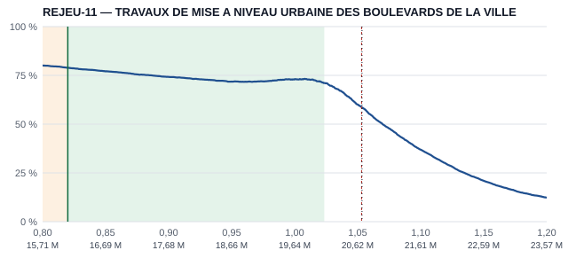
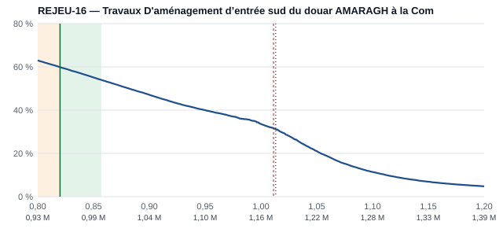
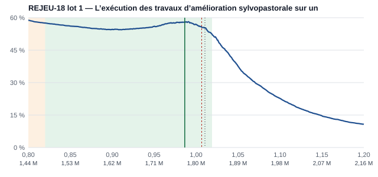

# Copilote — étape C2 : nombre recalé, calibration lissée, taux fixes de 2025, plancher légal

Tests : `python -m unittest discover -s tests -t .` → **368 OK** (6 nouveaux, cas communs mis à jour).
`python tester_ao_ouverts.py` → tous les contrôles passent. `serveur.py` n'est pas modifié.

Mesures :
- `python -m copilote.mesures_simulation tout` → `rapports/copilote_etape_C2_mesures.json`.
- Le fichier de l'étape C (`copilote_etape_C_mesures.json`) est gardé tel quel.

Tout est appris sur 2025 et mesuré sur 2026 : 500 marchés, plus les 20 AO REJEU (27 lots).

## FEU VERT C2

| critère | 2026 | seuil | | REJEU (27 lots) |
|---|---:|---|---|---:|
| (a) vrai P dans l'intervalle 80 % | **78,4 %** | 70 à 90 % | **OK** | 92,6 % |
| (b) écart moyen de P | **2,56 pt** | ≤ étape 4 sur les mêmes marchés (2,63) | **OK** | 1,62 (étape 4 : 2,11) |
| (c) tranches de chance à ±5 points | **7 sur 9** (90–100 % vide) | au moins 9 sur 10 | **KO** | 0 sur 8 |
| (d) zone contre taux fixe choisi sur 2025 | **58,6 %** contre 57,4 % ; **4 tranches sur 4** | au total et 3 sur 4 | **OK** | 40,7 % contre 33,3 % |
| chance annoncée au point recommandé | 57,4 % annoncé, 58,6 % réel (−1,2) | — | | 55,0 % contre 40,7 % (**+14,3**) : **KO** (< 10) |

Deux critères restent KO.
- **(c)** Les tranches 40–50 % (−6,7) et 80–90 % (+10,9, seulement 29 points) sortent de ±5.
- **REJEU** : 27 lots seulement, ce qui fait une erreur type d'environ 10 points sur cette moyenne.

## 1. Nombre de concurrents recalé (point 2)

**Constat.** Le tableau de C (« 3,7 simulés contre 1,4 réels ») rangeait les marchés par nombre **réel**.
- Ce tri exagère l'écart mécaniquement : un marché où il est venu 1 ou 2 sociétés est, par définition, un marché où il en est venu moins que prévu.
- Le seul recalage apprenable à l'avance se fait par nombre **prévu**.
- Rangés ainsi, les marchés de 2025 tenus à part ont en réalité **plus** de concurrents que prévu, et avec une queue haute plus longue.

**Correction.** `probables.recaler`, avec la même copie `AnalyseCalcul.recaler` dans le navigateur.
- Elle prend le nombre prévu m = espérance de la loi A2.
- Elle en déduit un ajout au décalage et un facteur de σ, interpolés en log m.
- Elle est refaite quand on décoche une société : la page et le simulateur la recalculent tous les deux.
- La table vit dans `probables.json` (`recalage_nombre`).
- Elle est apprise par vraisemblance sur **1 500 marchés de 2025 hors de l'échantillon d'ajustement de A2**
  (`python -m copilote.mesures_probables recaler`).

| nombre prévu | marchés 2025 | prévu moyen | réel moyen / médian | ajout au décalage | facteur σ | fourchette 80 % : avant → après |
|---|---:|---:|---:|---:|---:|---:|
| < 2 | 48 | 1,6 | 3,5 / 2 | +1,05 | ×1,625 | 83 → 92 % |
| 2–3 | 167 | 2,5 | 3,9 / 3 | +0,45 | ×1,0 | 81 → 90 % |
| 3–4,5 | 309 | 3,8 | 4,6 / 3 | +0,10 | ×1,0 | 88 → 90 % |
| 4,5–7 | 351 | 5,6 | 7,1 / 4 | +0,30 | ×1,125 | 84 → 86 % |
| 7–11 | 337 | 8,7 | 11,1 / 6 | +0,20 | ×1,125 | 78 → 82 % |
| ≥ 11 | 288 | 16,4 | 15,8 / 11,5 | +0,20 | ×1,125 | 76 → 81 % |

**Critères de A2 (mêmes marchés, sans → avec recalage)** : ils restent au-dessus des seuils.

| | 2026, 500 marchés : sans | avec | REJEU : sans | avec |
|---|---:|---:|---:|---:|
| vrais soumissionnaires dans le top 15 (≥ 30 %) | 33,8 % | **33,8 %** | 40,5 % | 40,5 % |
| vrai gagnant dans le top 30 (≥ 40 %) | 43,4 % | **43,4 %** | 70,4 % | 70,4 % |
| vrai nombre dans la fourchette 80 % (70–90 %) | 80,0 % | **84,8 %** | 70,4 % | 74,1 % |
| au-dessus de la fourchette | 15,8 % | 10,0 % | 29,6 % | 25,9 % |
| largeur moyenne de la fourchette | 10,8 | 13,5 | 10,2 | 13,1 |

Le recalage ne change pas le classement des sociétés, donc le top 15 et le top 30 sont identiques.

**Dans la simulation, 2026** (offres admises, moyenne) :

| rangés par nombre simulé | 3–5 | 5–8 | 8–12 | ≥ 12 |
|---|---:|---:|---:|---:|
| marchés | 229 | 123 | 92 | 55 |
| simulé / réel | 3,8 / 3,4 | 6,3 / 6,1 | 9,7 / 8,4 | 18,4 / 18,1 |

- Rangés par nombre réel, les écarts restent : 1-2 : 4,9 / 1,4 ; 3-4 : 7,0 / 3,4 ; 5-7 : 7,8 / 5,8 ; 8+ : 10,3 / 18,7.
  C'est l'effet de tri décrit plus haut, inévitable.
- En moyenne sur les 500 marchés, la simulation surestime maintenant de 0,5 offre (7,1 contre 6,6), au lieu de sous-estimer de 0,9.

## 2. Calibration lissée (point 3)

Les essais sont faits sur 300 marchés de 2025 pris hors des deux échantillons précédents (ajustement de A2 et recalage).

**Facteur de marché.**
- Il a été réglé à nouveau, puisque le nombre change.
- Vrai P dans l'intervalle 80 % : 1,4 → 74 %, **1,8 → 81 %**, 2,2 → 85 %. Je garde 1,8.

**Les deux calibrations essayées**, apprises sur 2025 et mesurées sur 2026 :

| calibration | (c) tranches à ±5 | (d) zone / fixe 2025 | tranches battues | REJEU au point recommandé |
|---|---:|---:|---:|---:|
| logistique à 2 paramètres : a + b·logit c | 6 sur 10 | 53,8 / 57,4 | 2 sur 4 | +4,9 pt |
| **logistique à 3 paramètres : a + b·logit c + g·(x − 1)** | **7 sur 9** | **58,6 / 57,4** | **4 sur 4** | +14,3 pt |

**Version retenue : 3 paramètres**, par tiers de nombre prévu (< 5,5 ; 5,5–10,5 ; ≥ 10,5) :
- a = −0,23 / −0,94 / −0,98 ;
- b = 0,78 / 0,42 / 0,44 ;
- g = −1,4 / −5,4 / −4,6.

Ce que fait g :
- g < 0 : en 2025, une offre basse gagnait plus souvent que la simulation ne le disait.
- Le terme corrige la **forme** de la courbe, pas seulement son échelle.
- Le point recommandé et la zone se lisent donc sur la chance calibrée.

Choix du nombre de tranches :
- Il est fait **par validation croisée sur 2025 seulement**. Log-perte : 2 tranches 0,584 ; 3 tranches 0,589 ;
  4 tranches 0,601 ; 5 tranches 0,607. Zone : 3 tranches 49,9 %, la meilleure.
- Sur 2026, 4 ou 5 tranches passeraient (c), avec 8 sur 9 ou 9 sur 10. Mais les choisir d'après 2026 serait régler
  sur l'année de test : je ne l'ai pas fait.

## 3. Comparaison honnête (point 4) et plancher légal (point 5)

- **Plancher légal** : une offre de plus de 20 % sous l'estimation est écartée d'office (décret 2-22-431).
- Le point recommandé, la zone et les taux fixes ne descendent jamais sous **0,82** (`simulation.json`, `plancher`, réglable).
- La grille reste 0,80–1,20.
- Sous **0,85**, la page affiche « proche du seuil d'offre anormalement basse » : sur la courbe (bande orange),
  dans la zone, au survol et sur le prix saisi.
- Un prix saisi sous 0,80 est annoncé « écarté d'office ».

**Zone contre taux fixes, 2026.** Le taux fixe de chaque tranche est choisi sur 2025, puis appliqué tel quel.

| offres | n | zone | taux fixe de 2025 | ses victoires | 0,95 fixe | après coup, pour information |
|---|---:|---:|---:|---:|---:|---:|
| 1-2 | 192 | **93,8 %** | 0,8325 | 92,7 % | 87,0 % | 93,8 % à 0,8225 |
| 3-4 | 98 | **69,4 %** | 0,82 | 68,4 % | 42,9 % | 68,4 % à 0,82 |
| 5-7 | 86 | **36,0 %** | 1,01 | 33,7 % | 20,9 % | 34,9 % à 0,82 |
| 8+ | 117 | **8,5 %** | 1,0175 | 7,7 % | 7,7 % | 14,5 % à 1,01 |
| tout | 493 | **58,6 %** | par tranche | 57,4 % | 47,9 % | 58,0 % à 0,82 |

**À savoir.** Le point recommandé vaut **0,82 sur 92 % des marchés** de 2026.
- Avec l'objectif « meilleure chance de gagner », la règle de la commission pousse presque toujours vers le plancher.
- La zone n'est vraiment utile que lorsqu'elle s'en écarte : 8 % des marchés, par exemple REJEU-18.
- L'étape 8 (coût, marge) remplacera cet objectif par la meilleure espérance de marge.

## Corrections proposées pour les deux critères KO

1. **(c)** Apprendre la calibration sur 1 000 marchés de 2025 au lieu de 300 (environ 1 h de calcul), puis choisir à nouveau
   le nombre de tranches par validation croisée sur 2025. Avec plus de données, 4 ou 5 tranches pourraient se justifier
   sans regarder 2026 ; or elles passent (c) sur 2026.
2. **REJEU (+14,3 points)** :
   - Ce sont surtout de gros marchés (13 lots sur 27 à 8 offres et plus), avec une erreur type d'environ 10 points.
   - La logistique à 2 paramètres y était à +4,9, mais elle échoue (d) sur les 500 marchés : je l'ai écartée.
   - À remesurer sur les REJEU-R quand le portail répondra : `python -m copilote.rejeu_recent` écrit maintenant la section
     « Étape C2 » avec ces critères.

## Trois exemples (REJEU, réglages finaux)

Sur les courbes :
- vert : zone et point recommandés ;
- orange : sous 0,85 ;
- rouge pointillé : offre gagnante réelle ;
- noir pointillé : vrai P.

**1. REJEU-11** — mise à niveau urbaine d'Ahfir, 19,6 M DH.
- 4 offres réelles ; nombre prévu 3,9, fourchette 1–8.
- Zone 0,82–1,024 ; 78,9 % à **0,82** (avertissement : proche du seuil).
- P 1,060 [1,022 ; 1,099] ; vrai P 1,053.
- Gagnant réel à 1,053. **Notre point aurait gagné.**

**2. REJEU-16** — entrée sud du douar Amaragh (Tiznit), 1,16 M DH.
- 19 offres réelles ; nombre prévu 7,1, fourchette 1–15 (4,8 offres simulées en C, 6,2 maintenant).
- Zone 0,82–0,857 ; 59,9 % à 0,82.
- P 1,032 [0,995 ; 1,071] ; vrai P 1,013.
- Gagnant réel à 1,011. **Notre point aurait perdu.**

**3. REJEU-18 lot 1** — amélioration sylvopastorale, 1,80 M DH.
- 9 offres réelles ; nombre prévu 4,1, fourchette 1–8.
- Zone 0,82–1,019 ; **58,0 % à 0,9865**, un des rares cas hors plancher.
- P 1,038 [0,993 ; 1,086] ; vrai P 1,011.
- Gagnant réel à 1,007. **Notre point aurait perdu**, il était trop haut.

Détail : `rapports/copilote_etape_C2_exemples.json`.

## Limites

- **Contrôle de la page** : il n'a pas été fait dans le navigateur, car l'extension Chrome n'était pas connectée.
  À la place :
  - syntaxe du script de la page vérifiée ;
  - sur le dossier réel de REJEU-18 lot 1, la fourchette (1–8) et la zone (0,82–1,019) sont identiques en Python et en
    JavaScript, et le recalage est bien refait quand on décoche une société.
- **Prévisions figées** : les 4 prévisions d'avant C2 ne sont pas touchées. Sans table de recalage, la page garde leur
  décalage ; elle leur applique le plancher par défaut.
- **Apprentissage** : la calibration est apprise sur seulement 296 marchés attribués de 2025.

## À tester par Hamza

1. Ouvrir `/copilote/analyse/REJEU-18?lot=1`, puis REJEU-11.
   - ③ « Comment c'est calculé » montre la ligne « Recalage selon le nombre prévu ».
   - Décocher une société : la fourchette change.
2. ⑤ Vérifier la bande orange sous 0,85 et l'avertissement « proche du seuil d'offre anormalement basse » quand la zone y
   descend.
   - Saisir un prix sous 0,80 de l'estimation : « écartée d'office (décret 2-22-431) ».
   - Vérifier que le point recommandé n'est jamais sous 0,82.
3. ⑤ « Comment c'est calculé » : la ligne de calibration (a, b, g), et le plancher.
4. Sur un vrai AO ouvert : figer une prévision. Ouvrir une des 4 anciennes prévisions : elle s'affiche toujours.
5. Lire la page à 390 px et à 1 440 px.
6. **Décider** :
   - si l'on lance la correction (c) (1 000 marchés de 2025) ;
   - si l'écart REJEU de +14 points sur 27 lots est acceptable en attendant les REJEU-R.

## Prochaine étape

Selon ta décision : correction (c), puis remesure. Ensuite étape 8 (coût, marge, GO / À ÉTUDIER / NO-GO), qui remplacera
l'objectif « meilleure chance », aujourd'hui presque toujours au plancher.
